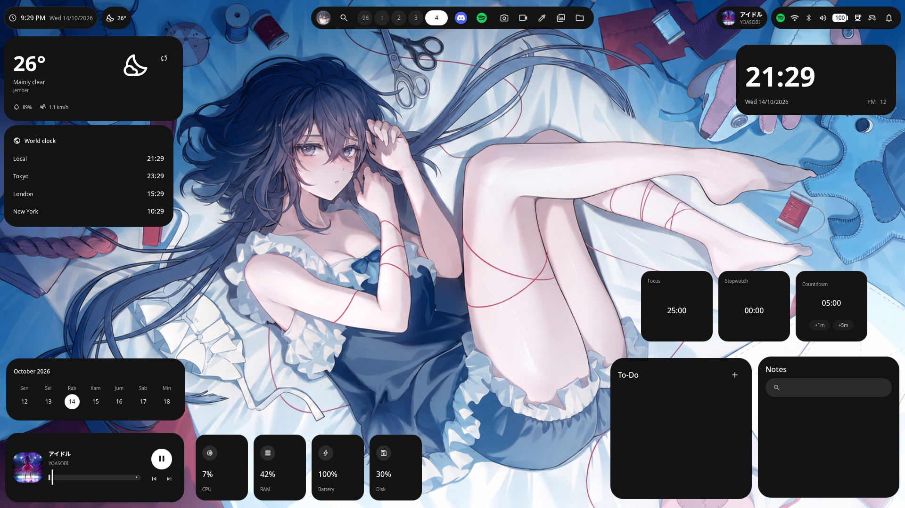

# nshell

A desktop shell

nshell brings the desktop bar, application launcher, control center, widgets, and session locking into a single configurable shell, with a collection of lightweight everyday apps built in.

  

Just use it
